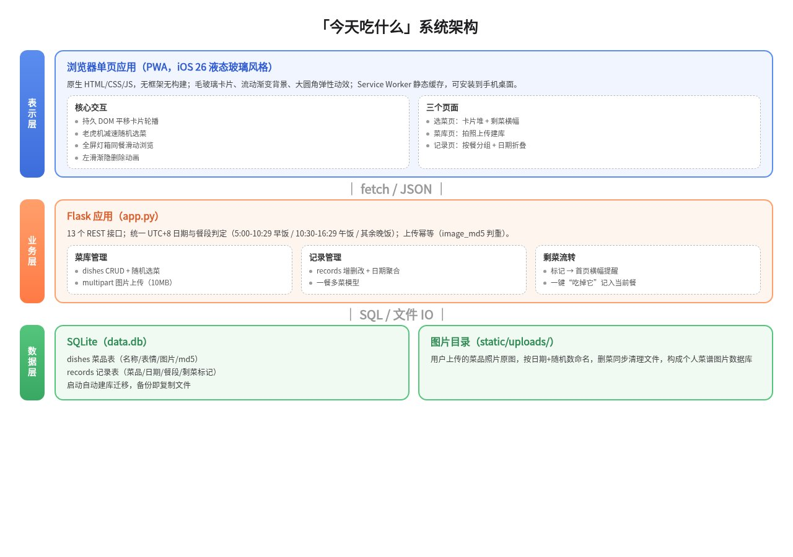
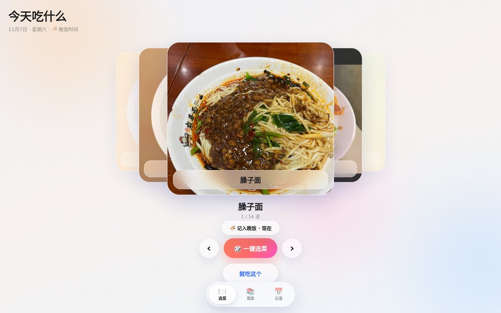
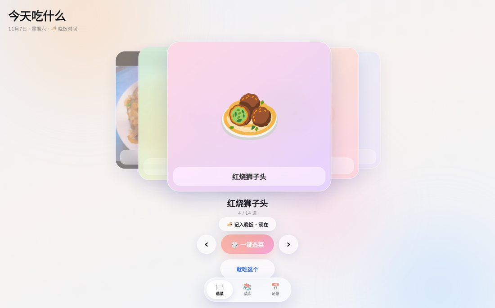
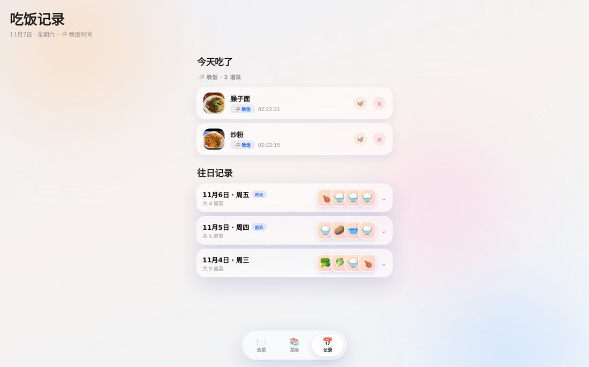
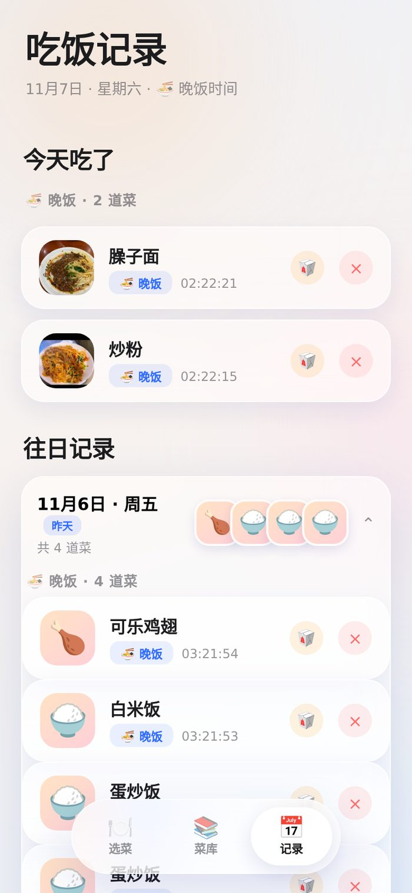
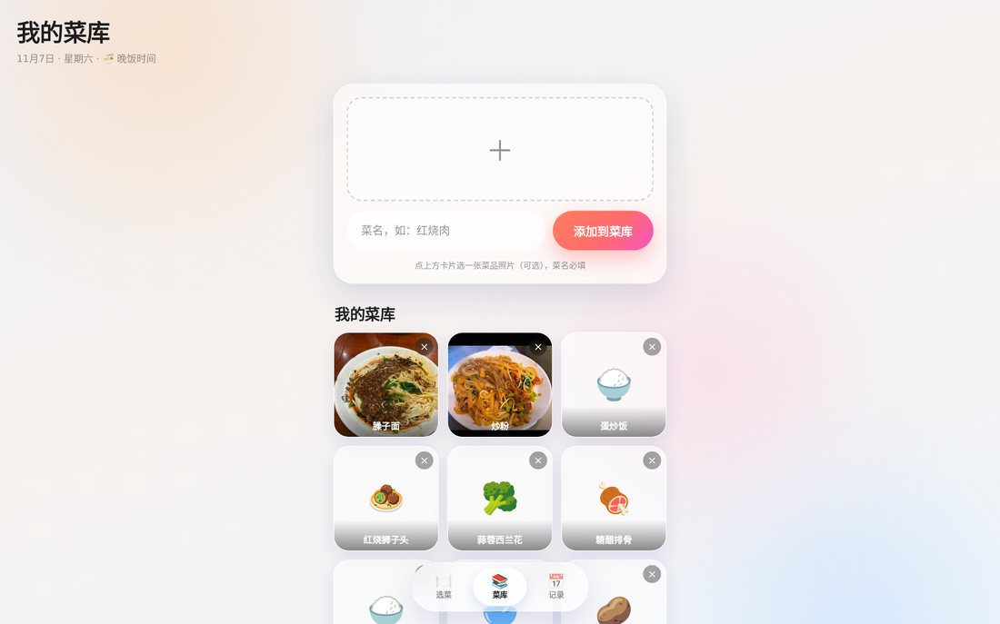

# 从一句话需求到上架华为云作品陈列馆：我用 AI 结对开发"今天吃什么"App 全记录

【摘要】 一句话需求："请帮我创建一个可以运行的作品 apk 加网页项目（今天吃什么）"。AI 交付了完整的 iOS 26 液态玻璃风格应用：Flask + SQLite 后端、滑动选菜、一键摇菜、早午晚饭记录、剩菜管理，还配齐了文档和 PWA。本文记录全程四轮迭代、两个线上 bug 修复、沙箱踩坑实录，以及最终发布到华为云作品陈列馆的完整路径，文末附可直接复用的提示词。

## 一、缘起：每天都要回答的灵魂拷问

"今天吃什么？"

如果你也是每天在家做饭的人，这个问题每天至少出现三次。更麻烦的是：想不出吃什么、忘了上次吃过什么、冰箱里的剩菜总是被遗忘到坏掉。市面上的菜谱 App 又重又杂，我只想有个轻量的小工具——打开就能滑卡片选菜，选完顺手记一笔，第二天能看到剩菜提醒。

于是我决定试试 AI 结对开发：把需求甩给 AI，我来验收。整个项目从第一句话到上架华为云作品陈列馆，一个下午加一个晚上完成。本文是完整复盘。

## 二、一句话需求，AI 全栈交付

我的原话是这样的（这就是全部需求）：

> 请帮我创建一个可以运行的作品 apk 加网页项目（今天吃什么）。作品用途是记录每天的菜，可以左右滑动选菜，一键选菜，主要用户是每天在家做饭的人，需要包含上传图片作为数据库，左右滑动照片选菜，界面风格希望是 iOS 26 风格。完成后请启动项目供我预览。

AI 的交付超出预期：

- **技术栈**：Flask + SQLite 后端，原生 HTML/CSS/JS 前端（无框架、无构建），PWA 支持
- **核心功能**：卡片堆左右滑动选菜、老虎机式一键摇菜、图片菜库、吃饭记录
- **视觉**：真正的 iOS 26 液态玻璃——毛玻璃卡片、流动渐变光斑背景、大圆角弹性动效
- **关于 APK**：沙箱里没有 Android SDK，AI 给了替代方案——PWA 直接安装到手机桌面（全屏、类原生体验），另附 Capacitor 打包真 APK 的完整文档

架构一图看懂：

三层结构清晰：前端 SPA 通过 fetch/JSON 调 Flask 的 13 个 REST 接口，数据落 SQLite 单文件库 + 本地图片目录。备份数据库 = 复制两个文件夹，这对个人工具来说刚刚好。

## 三、四轮迭代实录：像产品经理一样提需求

AI 一次性交付的版本能用，但细节必须靠人肉验收。回顾四轮迭代，每轮我只做两件事：**指出问题 + 明确预期效果**。

### 第一轮：餐段与剩菜

第一版的问题是"记录没有归属"——菜记了，但不知道是午饭还是晚饭；首页左右滑动时前后翻页预览是同一张卡。

我提了四个需求：翻页要有动画、按时间自动分早午晚饭、修"就吃这个"后记录不显示的 bug、加剩菜功能。

**这里有个值得说的 bug**：点"就吃这个"后记录页空空如也。AI 排查发现根因是时区——前端用 `toISOString()` 取的是 UTC 日期，和服务器日期错开一天，记录存了但查询条件对不上。修复方案是前后端统一日期（后端固定 UTC+8，前端用浏览器本地日期）。这个 bug 对部署在海外服务器、用户在国内的场景特别典型，值得记住。

餐段判定规则也定了：5:00-10:29 归早饭，10:30-16:29 归午饭，其余时间归晚饭。选菜页有个胶囊按钮显示"🍱 记入午饭 · 现在"，手动可切。

### 第二轮：往日记录折叠与图片放大

提的需求：弹窗加关闭按钮（点击空白关闭 + 左滑渐隐动画）、往日记录改成"日期+缩略图"折叠列表、点击图片全屏放大、预置两条演示数据（昨天 3 道菜、前天 2 道）。

AI 还用 PIL 程序化画了两张示例图（红烧肉、番茄炒蛋）灌进菜库——演示数据立刻有了真实感。

### 第三轮：一餐多菜

我吐槽："一天也不是只吃一道菜呀！"演示数据改成一顿午饭 3 道菜、晚饭 2 道菜；记录页每餐分组；折叠头改成具体日期（"11月5日 · 周四"配"昨天"徽章），缩略图排在日期后面。

### 第四轮：交互手感打磨

这轮最有价值。我反馈了三个问题：首页补位动画方向不对、记录删除没有动画、然后说了句关键的话——**"有什么问题先问我不要乱猜"**。

AI 一次性问了四个问题：翻页用哪种效果（平移/淡入淡出/3D 翻书）？滑动浏览范围（同餐/当天/全部）？浏览界面形式（全屏大图/卡片堆）？往日记录是否回退竖版列表？

我选了平移轮播 + 同餐滑动 + 全屏大图。确认后的实现一次到位：

这轮的教训（写给以后的自己和 AI）：**交互类需求歧义大，先问再做，一次问清，比返工三轮强**。

## 四、两个线上 bug：删除闪烁与重复上传

上线（发布到陈列馆）后我在实际使用中又发现两个问题，这两个都是真实用户才会遇到的：

**删除闪烁**：点删除后条目左滑消失时"闪一下"。根因在前端：删除动画结束后调用了 `loadHistory()` 全量重建列表，其他条目被销毁重绘。修复是动画结束后只做局部 DOM 清理——移除该条目、清掉空了的分组标题、更新计数。

**重复上传**：网络慢时点"添加到菜库"没反应，多点几次，菜库里出现三四个同名菜。修复是双保险：

- 前端：提交时按钮禁用并显示"上传中…"（try/finally 恢复）
- 后端：给 dishes 表加 `image_md5` 列，10 分钟内同名同图（md5 相同）的重复提交直接返回已有记录

后端幂等这层是关键——前端防重只能拦"手快"，网络重试、脚本重放都拦不住，只有服务端判重才是真保险。

## 五、沙箱踩坑实录（硬核部分）

项目在华为云 AI 开发者空间（码道 CodeArts 沙箱）里开发，环境是 openEuler aarch64。这一节是给同样在沙箱里折腾的同学的干货，每条都实测踩过：

| 坑 | 现象 | 解法 |
| --- | --- | --- |
| PYTHONHOME 污染 | yum 报 `ImportError: cannot import name 'text_encoding'` | 沙箱自带 Python 的环境变量污染系统 Python，跑 yum 前先 `env -u PYTHONHOME -u PYTHONPATH` |
| yum 事务校验失败 | 装 CJK 字体报 "needs 299MB more space on /etc"（实际磁盘够） | 挂载点误报，绕过：`yum --downloadonly` 下载 rpm 后 `rpm2archive` 解压到用户目录 |
| playwright 误判系统 | `install-deps` 尝试用 apt（系统是 yum 系） | 手动装缺失库，启动时 `LD_LIBRARY_PATH` 指向解压目录 |
| DevBridge 隧道连不上 | host 一直 "Connection failed, retrying" | 沙箱 DNS 无网关域名记录，/etc/hosts 只读改不了，只能放弃隧道（envUrl 留空照常发布） |
| hcloud 首次运行卡住 | 提示 Agree and continue | 非交互：`echo "y" | hcloud version` |

其中"下载 rpm 解压到用户目录"这招最通用——沙箱 /usr/local 只读、yum 又装不了的时候，`rpm2cpio`/`rpm2archive` + 用户级路径就是救命稻草。

## 六、开源与部署：双仓库 + 香港 VPS

代码同步推了两个仓库：GitHub（国际）和 GitCode（国内 + 华为云生态要求）。仓库里配齐了四份文档：

- `README.md`：功能、技术栈、快速开始
- `docs/DEVELOPMENT.md`：二次开发指南（架构、数据模型、API 表、扩展示例）
- `docs/DEPLOY_VPS.md`：VPS 生产部署（Gunicorn + systemd + Caddy 自动 HTTPS + 备份 cron）
- `docs/UPGRADE.md`：版本升级指南（含数据库迁移要点）

生产部署走我的香港 VPS：Caddy 反代自动签 HTTPS，手机浏览器"添加到主屏幕"即可安装 PWA。选香港的原因是国内直连无需备案，延迟 30-80ms 可接受。

## 七、发布到华为云作品陈列馆

最后一步是把作品发到陈列馆。官方指南（gallery/submit-guide）就三步：生成并验收作品 → 在 AI 对话中安装 Skill 发口令发布 → 打开作品详情页点"分享作品"。

实际走通的流程：

1. 安装发布 skill：`npx skills add https://gitcode.com/Lingxi-HandsOn/gallery.git --skill huawei-cloud-publish-work-to-gallery -y`
2. 发口令："请将当前项目发布至开发者作品展览馆"
3. AI 自动完成：解析华为云账号 Domain ID（需要先创建 SELF_VERIFY 自委托）、GitCode OAuth 授权建仓推代码、生成封面图（自动截图 + 合成）、写简介（字数校验 15-50 字符）、打详情包（详解文章 + 架构图）、选投稿活动、幂等发布
4. 我最后在作品页点"分享作品"发朋友圈

发布成功的作品页：https://gallery.developer.huaweicloud.com/gallery/007d2cae66401000

有个认知纠正：**"开发者作品展览馆"是平台本身，不是赛道**。发布 API 要求 `trainingCampId` 必填——作品必须挂靠一个活动才入馆展示。我从 51 个可投稿活动里选了"华为云AI产品实践"。发布后还领了成长积分（每月限一次，发放有 1~3 小时延迟）。

## 八、可直接复用的提示词

把这次全流程沉淀成三段提示词，你拿去就能用。

**1. 开发新作品（第一句话）**：

> 请帮我创建一个可以运行的作品 apk 加网页项目（作品名）。作品用途是【一句话】，主要用户是【人群】，需要包含【核心功能，2-4 条】，界面风格希望是【风格】。完成后请启动项目供我预览。

**2. 迭代反馈（验收时）**：

> 【指出具体问题】+【描述期望效果】。有什么不确定的先问我，不要自己猜。

后半句价值千金——交互类需求先对齐再动手，能省掉大半返工。

**3. 部署 agent 升级（VPS 运维）**：

> 请升级 whattoeat 服务：先备份数据库 → git pull → 执行数据库迁移（必须手动跑 init_db，gunicorn 不会自动触发）→ 重启服务 → 验证上传幂等和删除动画 → 报告每步结果。

## 九、总结

回头看这个项目最有意思的三件事：

1. **一句话就能启动**：AI 交付的不是玩具，是带文档、带测试、带部署方案的完整作品
2. **人肉验收不可替代**：四轮迭代里的每个 bug（时区、动画方向、防重）都是真实使用才暴露的，AI 写得快，但"好不好用"只有人知道
3. **踩坑即资产**：沙箱里那些 PYTHONHOME、rpm2cpio、DNS 的坑，沉淀成记忆和文档后，下一个项目直接绕开

"今天吃什么"现在的日常：早上规划三餐，做饭前翻卡片找灵感，饭后顺手记录，第二天打开看到剩菜提醒。它解决的就是这么小的一件事，但每天都会打开。

代码仓库（含完整文档）：

- GitCode：https://gitcode.com/i125pro/today_eat
- GitHub：https://github.com/i125pro/today_eat

作品在线展示：https://gallery.developer.huaweicloud.com/gallery/007d2cae66401000

**END**
